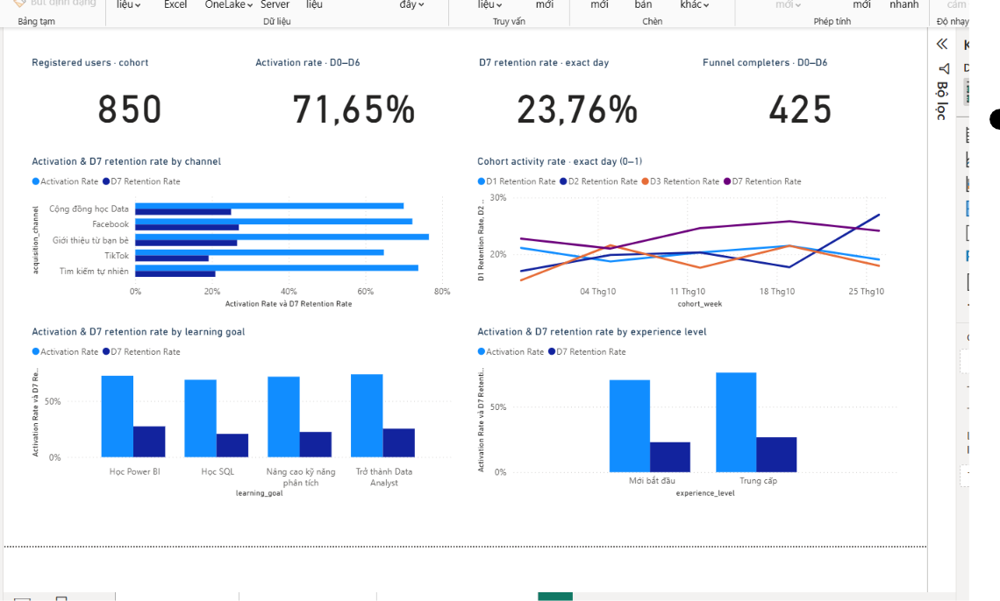

# DUA Edu · User Activation & Retention

Phân tích hành vi học tập của **850 người dùng giả lập** đăng ký trong tháng 10/2026. Bộ dữ liệu có **9.455 sự kiện** đến hết ngày 10/11/2026. Mục tiêu là tìm bước rơi trong hành trình học và xác định nhóm cần ưu tiên thử nghiệm.

| Chỉ số | Kết quả |
|---|---:|
| Activation trong D0–D6 | 609/850 · **71,65%** |
| D7 Retention đúng ngày | 202/850 · **23,76%** |
| Bắt đầu → hoàn thành trong funnel | 425/609 · **69,79%** |

- **Bắt đầu → hoàn thành** là bước rơi lớn nhất, với 184/609 người chưa hoàn thành trong cửa sổ D0–D6.
- **TikTok** có Activation 64,81% và D7 Retention 19,14% trên 162 người đăng ký. Đây là hai tỷ lệ thấp nhất trong năm nguồn.
- **Nhóm đã Activation** có D7 Retention 28,24% (172/609). Nhóm chưa Activation đạt 12,45% (30/241). Chênh lệch mô tả là 15,79 điểm phần trăm.

## Dashboard Power BI



[Tải báo cáo Power BI (.pbix)](powerbi/DUA_Edu_Dashboard.pbix) · [Funnel và cohort](powerbi/previews/02-funnel-cohorts.png) · [Bài học và chiến dịch](powerbi/previews/03-learning-campaigns.png)

Ba trang theo dõi KPI và phân nhóm người dùng, funnel theo tuần và nguồn, cùng hiệu quả từng bài học và mức độ quay lại của người tham gia chiến dịch. Hai view bài học và chiến dịch có dữ liệu tổng hợp ở cấp bài hoặc chiến dịch.

## Cách đo

- **Activation** đếm người có ít nhất một sự kiện `start_lesson` trong D0–D6, với D0 là ngày đăng ký theo giờ Việt Nam. Mẫu số là số người có đủ cửa sổ quan sát.
- **D7 Retention** đếm người có ít nhất một hoạt động đúng ngày đăng ký + 7, trên số người đủ thời gian theo dõi D7.
- **Funnel D0–D6** đếm người đi đúng thứ tự `sign_up → log_in → view_content → start_lesson → complete_lesson`. Ba bước học ghép theo cùng `content_id`.
- **Phân tích bài học** đếm theo cặp người dùng và bài học. **Phân tích chiến dịch** tính người tham gia trong D0–D6 có đủ độ phủ D7. Một người có thể tham gia nhiều chiến dịch. Các chênh lệch giữa nhóm là kết quả quan sát trên dữ liệu giả lập.

## Chạy lại phân tích

1. Đặt bốn CSV từ bộ dữ liệu challenge vào [`data/raw/`](data/raw/README.md). Notebook nhận các tên `Users.csv`, `Events.csv`, `Content.csv`, `Campaigns.csv` hoặc các tên đó kèm tiền tố `DUA Edu_Intern - `. CSV nguồn dùng qua bản xuất do challenge cung cấp.
2. Mở thư mục gốc trong VS Code hoặc Jupyter. Tạo môi trường Python 3 và cài thư viện.

   ```powershell
   python -m venv .venv
   .\.venv\Scripts\python.exe -m pip install -r requirements.txt
   ```

3. Chọn kernel `.venv` và chạy [`load_data_clean.ipynb`](load_data_clean.ipynb). Chế độ mặc định kiểm tra CSV và sinh `data/processed/data_quality_report.csv`.
4. Để nạp vào database mới, dùng SQL Server với Windows Authentication và Microsoft ODBC Driver 17 hoặc 18. Đặt `SQL_SERVER` theo tên instance trong notebook và bật `RUN_IMPORT=True`. Để cập nhật các view trên database đã nạp, dùng `RUN_VIEW_REFRESH=True` với `RUN_IMPORT=False`. Có thể bật `RUN_EXPORT=True` để xuất `data/processed/user_metrics.csv`.
5. Mở [`04_quality_checks.sql`](sql/04_quality_checks.sql) rồi [`05_analysis_reports.sql`](sql/05_analysis_reports.sql) trong SSMS. Đối chiếu funnel **850 → 797 → 710 → 609 → 425**. [`06_experience_learning_path.sql`](sql/06_experience_learning_path.sql) có phân tích bổ sung về lộ trình học.

Power BI đọc ba view `dbo.vw_user_metrics`, `dbo.vw_content_funnel` và `dbo.vw_campaign_retention`. Khi cần làm mới báo cáo trên máy khác, cập nhật tên instance trong **Data source settings**.
